<div align="center">

<!-- Animação: header.svg (tema escuro) e header-light.svg (tema claro), na raiz do repositório -->
<picture>
  <source media="(prefers-color-scheme: light)" srcset="./header-light.svg">
  
</picture>

</div>

## Sobre mim

Desenvolvimento de Sistemas · Instituto Federal do Paraná (IFPR)

```js
if (codeWorks) {
  dontTouch();
}
```

## GitHub Stats

<div align="center">


</div>

## Contato

<a href="mailto:20251foz0020023@estudantes.ifpr.edu.br">
  
</a>
<a href="https://github.com/NickollasKaiky">
  
</a>
